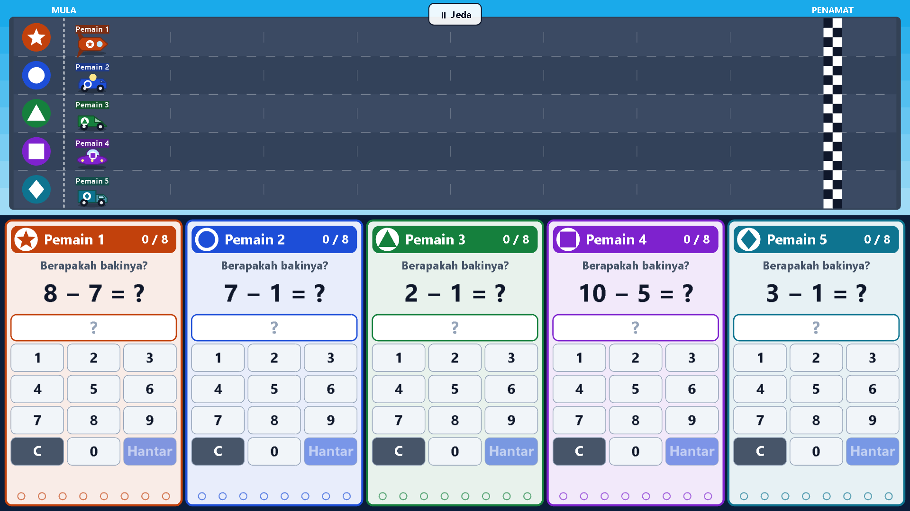

# MathRacing

An offline-first mathematics racing game for Malaysian **Year 1 and Year 2** classrooms (KSSR Semakan 2017, Edisi 3 alignment). Two to five pupils race on **one large touchscreen**: each has their own question panel, a correct answer moves their racer one step, and the first to the finish wins. It runs in the browser, installs as a Progressive Web App, and works with no internet once loaded.



- **Teacher setup in under a minute:** Year 1 or 2, one topic or a mixed race, difficulty level 1-4, 2-5 named players, Lumba Pantas (winner) or Latihan (no winner), 5/8/10/12 correct answers, Bahasa Melayu or English, sound, reduced motion, hints and support.
- **Fair and calm:** equal movement for every correct answer, same questions blueprint and level for everyone, private "Cuba lagi." on a wrong answer, no backwards movement, no public accuracy.
- **Curriculum-tagged evidence:** every attempt is stored locally with pack, year, topic, SK, template, level, answer, time, hint and support use. **MathRacing records evidence; it never assigns a Tahap Penguasaan (TP).** The teacher makes the professional judgement.
- **Private:** no accounts, server, analytics or tracking. Data stays on the device and can be exported (CSV) or deleted at any time.
- **77 question templates** across 15 topics, 5 widget types, all generated from a seed (reproducible) and covered by property tests. See [docs/CURRICULUM-MAPPING.md](docs/CURRICULUM-MAPPING.md).

> **Status and limits.** The curriculum packs are drafts pending review by a qualified Malaysian primary Mathematics educator, and the game plan supplies SK ranges but no SP codes (none were invented). Five-finger operation has been tested through the real browser input pipeline with simulated touches, **not yet on real panel hardware**: run [docs/MANUAL-TOUCH-TEST.md](docs/MANUAL-TOUCH-TEST.md) on each target panel. See "Known limitations" below.

## Prerequisites

- Node.js 22.12 or newer (developed on 24) and npm.
- A Chromium-based browser (Chrome or Edge) for classroom use.

## Setup

```bash
npm install
```

Everything (Phaser, Vite, Vitest, Playwright, ESLint, Prettier) is a local dependency; no global tools are needed. For the browser tests, download the test browser once:

```bash
npx playwright install chromium
```

## Everyday commands

| Command                           | What it does                                                                                                                                     |
| --------------------------------- | ------------------------------------------------------------------------------------------------------------------------------------------------ |
| `npm run dev`                     | Development server with hot reload (http://localhost:5173). Add `?diag` to the address to show the pointer-ownership overlay (development only). |
| `npm run build`                   | Type-checks, then produces the deployable static site in `dist/` (with service worker and manifest).                                             |
| `npm run preview`                 | Serves `dist/` at http://localhost:4173, as a school would host it.                                                                              |
| `npm run lint`                    | ESLint over the whole project.                                                                                                                   |
| `npm run typecheck`               | `tsc --noEmit` (strict).                                                                                                                         |
| `npm test`                        | Vitest unit and integration tests, one run (not watch mode). `npm run test:watch` for watch mode.                                                |
| `npm run test:e2e`                | Playwright end-to-end tests against the production build (builds and serves it automatically).                                                   |
| `npm run format` / `format:check` | Prettier.                                                                                                                                        |
| `npm run docs:curriculum`         | Regenerates `docs/CURRICULUM-MAPPING.md` from the live registry.                                                                                 |
| `npm run icons`                   | Re-renders the PWA icons from `public/icons/icon.svg`.                                                                                           |
| `npm run check`                   | lint + typecheck + unit tests + build.                                                                                                           |

## Using it in a classroom

1. Open the app once with internet (Chrome/Edge). After "Sedia digunakan tanpa internet." appears it works offline. To install it as an app, use the browser's **Install** button in the address bar (or menu → Cast, save and share → Install page as app).
2. **Setup:** choose the year, topics, level, players and options. **Pratonton 5 soalan** shows five sample questions with answers so you can check the content before starting. Use nicknames or initials only.
3. **Mula:** each pupil stands at the panel with their colour, symbol and name and touches their button to confirm (this doubles as a touch check), then a 3-2-1 countdown runs. **Mulakan sekarang** skips waiting.
4. **Racing:** pupils type an answer and press **Hantar** (choice tiles answer on tap). The small **Jeda** button above the track needs a press-and-hold (or press **Esc**) to pause; **Sambung** resumes. The race also pauses if the tab is hidden.
5. **Results:** the class sees finishing order and progress. **Main Lagi** starts a fresh race with the same setup and new questions; **Persediaan Baharu** returns to Setup; **Eksport CSV** downloads the evidence; **Papar bukti guru** shows teacher-only counts per pupil and per SK.

### Controls

- Touch or mouse on the panels; the canvas never scrolls, zooms, selects text or opens a context menu.
- Teacher screens are fully keyboard accessible (Tab, Space/Enter, Esc closes dialogs; skip link at the top).

## Data storage and deleting it

| What                             | Where                                             | Contains                                                                                                                                                                                                                                                                   |
| -------------------------------- | ------------------------------------------------- | -------------------------------------------------------------------------------------------------------------------------------------------------------------------------------------------------------------------------------------------------------------------------- |
| Evidence (sessions and attempts) | Browser IndexedDB database `mathracing-evidence`  | The session seed and settings, the nicknames you typed for that session, and one row per attempt (pack, year, topic, SK, template, level, answer, correctness, times, hint and support use, generation parameters). No surnames, IDs, birth dates, photos, audio or video. |
| Settings                         | Browser localStorage key `mathracing.settings.v1` | Classroom choices only (language, year, topics, level, mode, options). **Never player names.**                                                                                                                                                                             |

- **Delete one session:** Results → **Padam data sesi** → confirm.
- **Delete everything:** Setup → **Padam semua data sesi** → confirm.
- **Delete from the browser itself:** Chrome/Edge → Settings → Privacy and security → Site settings → View permissions and data stored across sites → this site → Delete. Or DevTools (F12) → Application → Storage → **Clear site data**.
- CSV export is UTF-8 with a byte order mark (opens correctly in Excel), and cells that could be read as spreadsheet formulas are neutralised.
- If the browser blocks IndexedDB (some private windows), the app says so and keeps data in memory only; it is lost when the tab closes.

## Deployment

`npm run build` produces a static site in `dist/` with relative paths. Copy it to any web server or shared folder that serves it over **https or http://localhost** (service workers require a secure context), or serve `dist/` locally with `npm run preview`. Because the base path is relative it works from a sub-folder. After the first successful load, no network is needed; a new build is picked up automatically on the next online load.

## Tests

- `npm test`: unit and integration tests for the seeded RNG, answer normalisation, every one of the 77 templates (1,000 generated samples per level for arithmetic templates: valid, tagged, deterministic, exactly one defensible answer, independently recomputed), curriculum registry rejection of malformed or duplicate packs, the race engine (exactly-once movement, per-player debounce, single winner and timestamp tie-break, hints, support, pause timing, practice mode, evidence log), the state machine, pointer ownership and its router, widgets, layout at 1280x720 / 1920x1080 / 3840x2160, storage (IndexedDB via `fake-indexeddb`), CSV formula-injection safety, locales, and the app controller flow with a fake game.
- `npm run test:e2e`: real Chromium against the production build: two-player race to a winner, replay and back to setup; every widget type; Year 2 in English; practice mode; pause; five-player layouts at three resolutions with screenshots; 2x display scaling; five simultaneous CDP touches with no cross-panel leakage; slide-in and slide-across rejection; CSV download and deletion after confirmation; offline boot; no remote requests. Screenshots are written to `e2e/screenshots/` (git-ignored).
- Automated tests do not replace the physical test in [docs/MANUAL-TOUCH-TEST.md](docs/MANUAL-TOUCH-TEST.md).

## Project layout

```
src/
  app/          AppController, Setup/Results screens, dialogs, stage chrome, styles
  curriculum/   schema, answer service, packs, template generators, registry, race blueprint
  game/
    core/       SeededRng, RaceEngine, state machine, pointer ownership, players (pure)
    widgets/    pure widget models (number pad, tiles, tap, order, build)
    ui/         layout (pure) and Phaser drawing (panels, track, visuals)
    scenes/     Boot, Ready, Race
    PointerRouter.ts, SoundService.ts, createGame.ts, session.ts
  locales/      bm.ts (complete), en.ts (falls back to bm per key)
  storage/      IndexedDB + in-memory repositories, settings
  reporting/    CSV export and teacher evidence summary
  tests/        unit and integration tests
e2e/            Playwright tests and helpers
docs/           ARCHITECTURE, CURRICULUM-MAPPING (generated), DECISIONS, MANUAL-TOUCH-TEST
public/icons/   original PWA icons
```

See [docs/ARCHITECTURE.md](docs/ARCHITECTURE.md) for the state machine, dependency direction and multi-touch design, and [docs/DECISIONS.md](docs/DECISIONS.md) for every assumption (including what the reference video does and does not show).

## Known limitations

- **Five-touch hardware is not validated.** Simulated multi-touch passes; a real panel must be tested with the manual protocol.
- **Curriculum content is unreviewed**: packs are `draft-pending-academic-review`, SP codes are absent (not in the plan), and a few plan items are not built (see the gaps list in the curriculum mapping).
- Cooperative/team modes, a clock-setting widget, shape drawing and a Year 1 "2027 pack" are not implemented.
- The service worker cannot register in Claude's embedded browser pane; offline behaviour is verified in Playwright's Chromium.
- The Phaser bundle is about 1.4 MB (375 KB gzipped); it is loaded when the first race starts and then cached.
- `example.mp4` (the reference video, which shows real pupils) is kept on disk but deliberately not tracked by git.
