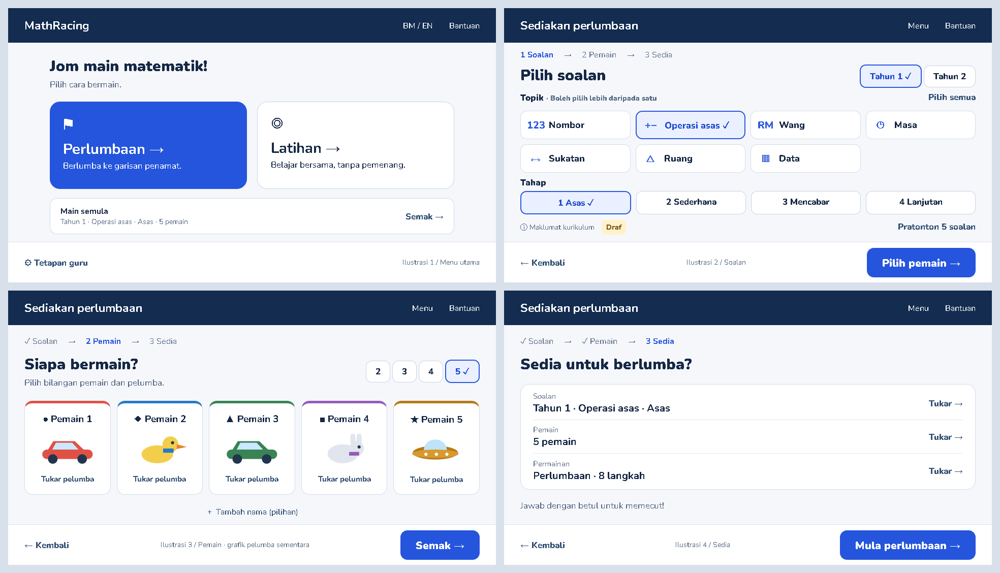

# Implementation plan: simpler MathRacing menus

Status: **implemented following owner approval** (DECISIONS #43). Prepared 2026-09-25.
Recommendations D1–D9 accepted. The original illustrations below remain design references, not app screenshots.
Implementation also handles Year 2's eighth topic (fractions and decimals), keeps name fields expanded once opened,
and supports an optional installed Chrome channel for browser tests. No APK/version change is part of this delivery.
The owner's request is to simplify menus, provide a few illustrations, and supply an implementation MD first.
The attached screenshot is a visual reference, not a source of instructions.

## Recommendation

Use a calm, light content area with a compact navy header. Give each screen one clear next action.
Reduce setup from four steps to **Soalan → Pemain → Sedia**, placing the year choice on the question screen.
Keep the familiar topic icons, four difficulty levels, existing racers, and offline behaviour.
Simplify what teachers see first; retain detailed controls through clearly labelled buttons.

The screenshot's main issue is competing information: seven formal topic titles and SK ranges, repeated stars,
large navigation pills, curriculum metadata, and several similarly prominent actions. More decoration alone
would not reduce the decisions a teacher has to make.

## Illustrations

These are static design proposals, not screenshots of a changed app. They use the bundled Nunito font and local
HTML/SVG. The simplified racer drawings are placeholders; implementation will reuse the existing racer artwork.
The illustrated selection is Tahun 1, Operasi asas, level 1, five players, eight steps. Existing saved choices
remain the actual defaults; the proposal does not impose this illustrated selection.

- [1. Main menu](menu-simple/01-home.png): two clear play modes and one compact repeat action.
- [2. Questions](menu-simple/02-questions.png): year, short topic labels, and four simple level choices.
- [3. Players](menu-simple/03-players.png): count and racer choices first; names are optional.
- [4. Ready](menu-simple/04-ready.png): three summary rows and one start button.
- [Editable static illustration source](menu-simple/illustrations.html).

Each illustration is drawn at **960 × 540 CSS pixels**, the current minimum landscape design target.
This shows the proposed space budget, not proof that the future app passes responsive or accessibility tests.

## Decisions for approval

| ID  | Choice           | Recommendation                                                                                                             | Trade-off                                                                                                      |
| --- | ---------------- | -------------------------------------------------------------------------------------------------------------------------- | -------------------------------------------------------------------------------------------------------------- |
| D1  | Scope            | Main menu, setup, teacher settings, and matching help text.                                                                | Race HUD, question panels, results, splash, and game rules stay outside this proposal.                         |
| D2  | Setup flow       | Three steps: Soalan, Pemain, Sedia.                                                                                        | One fewer page; year and question choices share a screen. A four-step restyle is the lower-change alternative. |
| D3  | Visual direction | Light background, compact navy header, blue primary actions, restrained borders.                                           | Changes the current large navy surround while keeping the existing font and identity.                          |
| D4  | Topic labels     | Short menu labels; formal titles, codes, SK ranges, pack/version and full notice in Maklumat kurikulum. Keep Draf visible. | Formal curriculum detail takes one additional tap. No curriculum data or codes change.                         |
| D5  | Selection        | Keep multiple topics, all four levels, and Pilih semua. Remove Kosongkan; selected topics can be individually deselected.  | Clearing a large selection takes more taps, but removes an easy route to an invalid setup.                     |
| D6  | Names and racers | Show racers and player count; reveal name inputs with Tambah nama (pilihan).                                               | Naming requires one extra tap. Already entered names remain visible when returning.                            |
| D7  | Ready screen     | Show three summary rows; mode and race length edit through the Permainan row.                                              | Less repeated choice on the final page; changing these settings needs one additional tap.                      |
| D8  | Teacher settings | Three sections: Permainan, Bantuan murid, Data & lanjutan; show one section at a time.                                     | Less information at once; switching sections costs a tap. Storage warnings and PBD notice remain visible.      |
| D9  | Motion           | Static home composition for the initial simplification; existing racers remain in player selection.                        | Removes the moving road from the menu. Racing animations are unaffected.                                       |

The owner approved the recommended design with “yes”; the implemented product rule is recorded in DECISIONS #43.

## Proposed behaviour

### Main menu

- Two large actions: **Perlumbaan** and **Latihan**, with one short explanatory line each.
- Main semula appears only under the existing history condition. Its summary includes the saved/current setup;
  it opens Sedia for review and never starts a race immediately.
- Keep BM/EN and Bantuan in the header, Tetapan guru in the footer.
- Move the routine session count to teacher settings. Keep any evidence-storage warning visible on the menu.
- Reuse the existing local font and icons. No downloaded images, external fonts, or additional dependencies.

### Step 1: Soalan

- A labelled Tahun 1 / Tahun 2 radio group sits beside the screen heading.
- Short topic choices: Nombor, Operasi asas, Wang, Masa, Sukatan, Ruang, Data. EN equivalents: Numbers,
  Basic operations, Money, Time, Measurement, Space, Data. Resolve labels through an explicit mapping from
  existing topic IDs, with the formal pack title as a fallback; do not alter the registry or pack files.
- Seven topic cards use a four-column, two-row layout at the target widths. No SK subtitles or numeric prefixes.
  Selected choices have a fixed check area, a blue border and a light fill, without text shifting.
- Use a compact radio row: 1 Asas / 2 Sederhana / 3 Mencabar / 4 Lanjutan. Remove repeated star decorations.
  Accessible group description: all players receive the same level.
- Changing year keeps the current rule: reset to that year's default operations topic. Selecting topics does
  not advance automatically. An empty selection disables the next action and displays Pilih sekurang-kurangnya
  satu topik, associated with the group; direct navigation to Sedia cannot bypass this validation.
- Maklumat kurikulum opens the actual pack title/version, complete draft notice, and the year's formal topic
  titles/codes/SK ranges. Draf stays visible next to its trigger. Never invent SP codes or imply academic approval.
- Keep Pratonton 5 soalan accessible. Preserve current preview generation and content in this pass; a rendered
  picture preview would be separate work because the existing dialog is text-based.
- Footer: Kembali and Pilih pemain. Use a slim text step indicator with accessible navigation, not large pills.

### Step 2: Pemain

- Count choices 2, 3, 4, 5; one racer card per active player with their slot number, symbol and colour.
- Preserve the existing vehicle/animal selector, unavailable-racer state, and collision resolution when a seat
  becomes active. Reuse racerSvg and the existing catalogue rather than the illustration's placeholder graphics.
- Blank names remain the default. Tambah nama (pilihan) expands labelled inputs within the cards and a short
  privacy note. The section stays expanded when any active player has a name; returning to this step preserves
  text and focus. At short heights, allow the content region to scroll when the Android keyboard is open.
- Player count changes preserve current session state rules. Names and seed remain in memory only, never settings.
- Footer: Kembali and Semak.

### Step 3: Sedia

- Three summary rows: Soalan (year/topics/level), Pemain (count and selected racers), Permainan (mode/length).
  With many topics, use a compact count and allow the question edit screen to show the full selection.
- Soalan and Pemain links open their respective steps. Track a transient return-to-review flag so finishing
  an edit returns directly to Sedia, rather than making the teacher repeat the remaining setup sequence.
- Permainan opens an accessible dialog with the existing quick/practice choices and RACE_LENGTHS, using current
  values. Apply with Selesai; dismissing cancels unconfirmed edits. Restore focus to its trigger on close.
- Show Mula perlumbaan or Mula latihan as appropriate. Use mode/movement-aware helper text: boost language only
  when cruise is enabled, and no winner claims in practice. Keep validation at the final start boundary.
- Main semula, results actions, early-end return paths and error recovery all open the new Sedia step.

### Teacher settings

- Section selectors: Permainan (sound, reduced motion, cruise and conditional setback), Bantuan murid
  (hints/support), Data & lanjutan (session count, data deletion, seed).
- Preserve settings immediately as today; seed remains session-only. Preserve values while switching sections.
- Keep storage warnings and the PBD notice outside the section switcher so they are always discoverable.
- Keep the existing confirmation for deleting evidence. Show setback only with cruise disabled.
- Use labelled buttons with a clear selected state and a heading for the active section. A selected section's
  content may scroll at short heights; do not squeeze labels or hide essential controls to force it to fit.

## Layout and accessibility requirements

- Validate 960×540, 1024×600, 1280×800 and 1920×1080, with both BM and EN. Account for the Android navigation bar
  using the existing minimum; do not add immersive mode. Below this minimum, use graceful content scrolling.
- Fixed-size header/footer with a flexible middle region (`min-height: 0`). Core setup choices fit without page
  scrolling at 960×540 with the keyboard closed; long dialogs and expanded teacher detail may scroll internally.
- Touch targets at least 48 px; primary actions and player controls at least 56 px. Mockup spans stand for future
  semantic buttons/inputs; their static illustration markup is not production accessibility implementation.
- Keep keyboard navigation, visible focus, associated labels, real radio/checkbox semantics, dialog focus
  trapping/restoration, and announced validation. Selection must be distinguishable without colour alone.
- Retain Nunito, reduced-motion handling, offline caching, and high contrast. Target WCAG AA contrast for text
  and controls. No app package, race engine, curriculum generation, evidence or CSV schema changes are intended.

## Implementation sequence and files

1. **Flow and wording.** Update `src/app/screens/SetupScreen.ts` from `SetupStep = 1 | 2 | 3 | 4` to the
   agreed three-step flow. Merge year selection into question selection; remap summary edit targets and add the
   transient return-to-review state. Update every `showSetup(4)` path in `src/app/AppController.ts`, including
   repeat, result returns, early exit, and errors. Write new strings in `src/locales/bm.ts` first, then `en.ts`.
   Preserve `setupState.ts` state/settings conversion; no persistence migration should be needed.
2. **Menu and question layout.** Update `MenuScreen.ts`, `SetupScreen.ts`, and `src/app/styles/app.css`.
   Scope CSS to these screens so Results, stage chrome, and dialogs elsewhere do not acquire unintended styles.
   Reuse `controls.ts`, `art.ts`, and `dialogs.ts`; change shared helpers only if their callers remain compatible.
3. **Players, ready, teacher.** Add name disclosure and the mode/length dialog; simplify `TeacherScreen.ts` into
   sections. Retain existing control IDs where their meaning survives, and update moved-control queries.
4. **Tests and documentation.** Adapt `src/tests/app.test.ts`, locale checks and affected colour assertions in
   `layout.test.ts`. Update `e2e/support.ts` to follow the new steps and reveal controls before interacting;
   update affected flow/layout assertions in `e2e/mathracing.spec.ts`, and preserve cruise/setback coverage.
   Update `src/app/help.ts`, README, and PROJECT_STATE; append the next available numbered decision to
   `docs/DECISIONS.md` once implemented. Regenerate the repo map if files are added/removed/renamed.
5. **Verify and commit.** One commit per logical implementation step. An APK rebuild/version bump is a separate
   delivery action if requested; this planning task does not create a release.

## Acceptance and verification

- Both play modes complete Soalan → Pemain → Sedia → existing ready/race flow for 2–5 players.
- Changing year gives valid topics; no-topic state cannot start; multi-topic and all four levels still work.
- Repeat, changing a summary row, returning from results, early exit and errors lead to the correct new step.
- Name disclosure preserves entered names in memory; reopening the app does not restore names from settings.
- Racers remain unique, keyboard focus survives edits/dialogs, and hidden advanced values are never reset.
- Teacher options, cruise/setback visibility, evidence warnings, deletion confirmation, and practice behaviour
  match the existing rules. Existing offline and multi-touch tests continue passing.
- No clipped labels, overlapping controls, hidden start action, or unintended page scrolling at target sizes,
  including five players and English. Inspect one representative 960×540 screenshot; use DOM bounds assertions
  for the other layout combinations and record remaining real-device keyboard/navigation-bar uncertainty.
- During implementation, use `npm run check:fast`, targeted app/locale tests and the relevant Playwright flow
  tests. Before the final multi-file commit, run `npm run check` and `npm run test:e2e` once.

## Original planning delivery

Only this plan and its static illustrations are created. Format/check the documentation and illustration HTML,
render and visually inspect the illustration sheet, regenerate the repo map, and commit the planning artifacts.
Do not edit application code, append an implemented decision, run the full app test suite, or build an APK yet.
